<div align="center">
  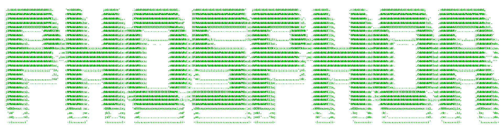

# Phosphor Cam

  <p align="center">
    <i>Transform your camera feed into real-time ASCII art</i>
  </p>

[](https://www.typescriptlang.org/)
[](https://github.com/pshycodr/phosphor-cam/actions/workflows/ci.yml?query=branch%3Amain)
[](https://github.com/pshycodr/phosphor-cam/releases/latest)

</div>

<div align="center">
  <a href="https://f-droid.org/packages/site.aroy.phosphor/">
    
  </a>
  <a href="https://github.com/pshycodr/phosphor-cam/releases/latest">
    
  </a>
  <a href="https://phosphor.aroy.site/">
    
  </a>
</div>

---

## Overview

Phosphor Cam converts a live camera stream into stylized text or dithered bitmap graphics on an HTML canvas. **Phosphor Studio** applies the same renderers to a photo you load from your device. It runs entirely client-side: frames are read from the `MediaStream`, processed and drawn locally, and are never uploaded.

Five render engines are available and can be switched at runtime without restarting the camera:

| Engine       | Output                                                                        | Typical use                         |
| ------------ | ----------------------------------------------------------------------------- | ----------------------------------- |
| **ASCII**    | Characters mapped to pixel luminance, optionally tinted with the source color | Text-art portraits, copyable output |
| **Dither**   | Reduced-tone bitmap rendering with a retro, print-like texture                | Stylized stills and video           |
| **Halftone** | Recreates an image as a grid of dots                                          | Stylized stills and video           |
| **Voxel**    | Render with pixeled effect and 3D blocks                                      | Stylized stills and video           |
| **Lines**    | Each row or column is one continuous ribbon                                   | Stylized stills and video           |

The app has two routes: `/` for the live camera and `/studio` for photo editing. Both share the same renderer pipeline and settings controls.

---

## Get the app

Phosphor Cam is available as a web app, a PWA, and a native Android app. The Android build ships from the same codebase, runs fully offline, and is signed and published automatically on every release.

The link above always points to the latest release. Grab the `.apk` from the Assets section and install it directly — no Play Store, no account, no internet required after install.

<div align="center">
  
</div>

---

## Demo

### ASCII

<div align="center">
  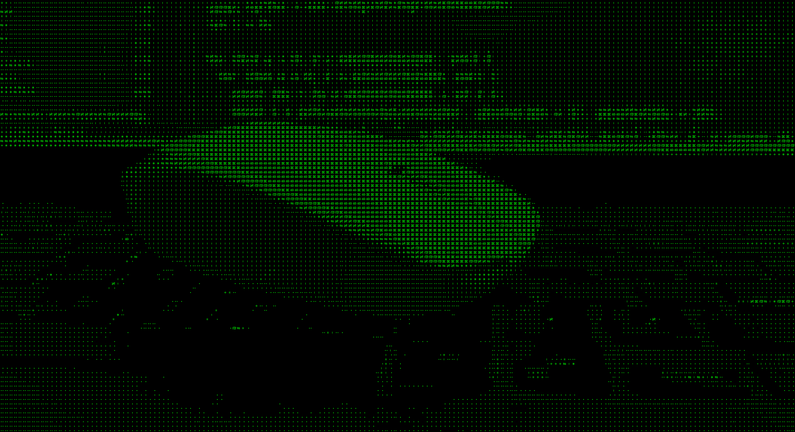
  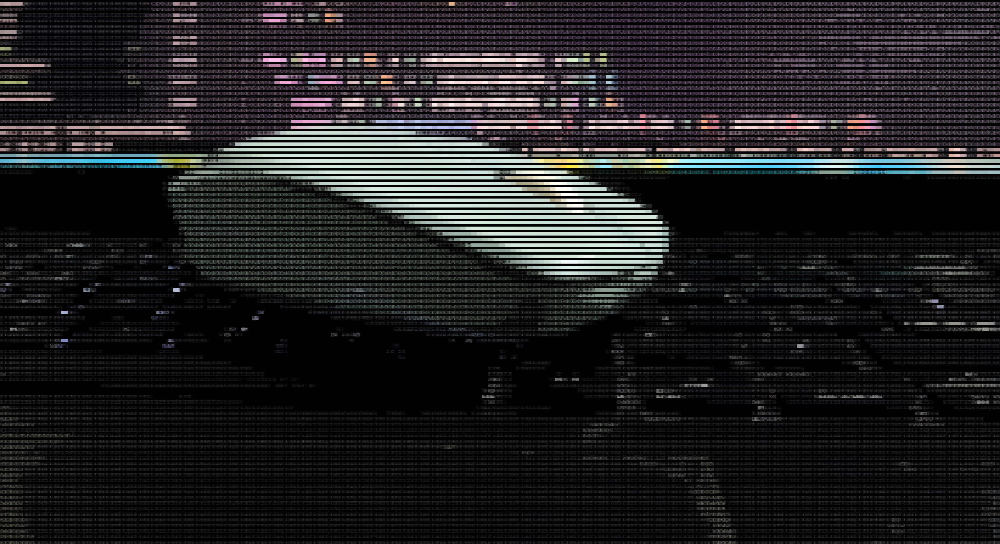
</div>

### Dither

<div align="center">
  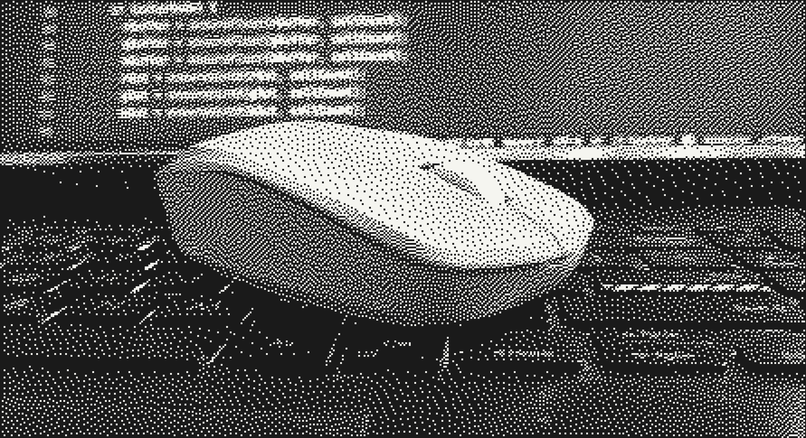
  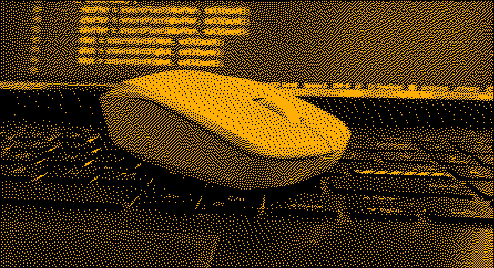
</div>

### Halftone

<div align="center">
  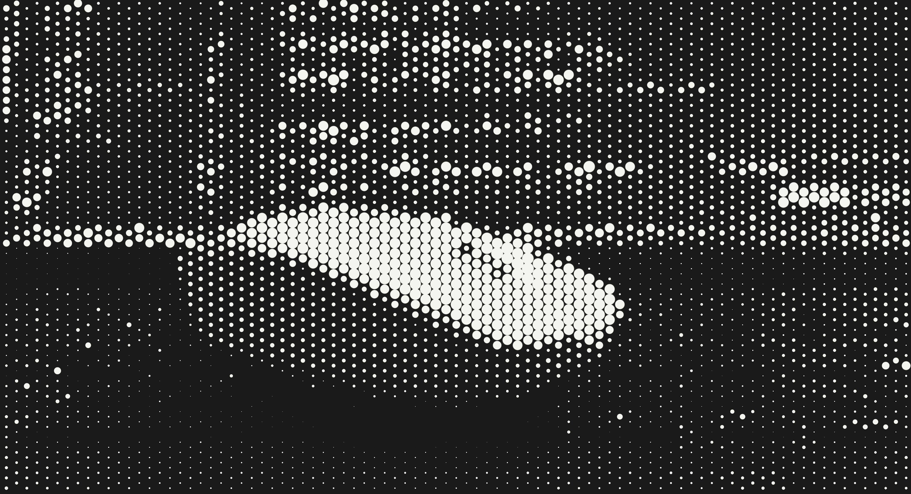
  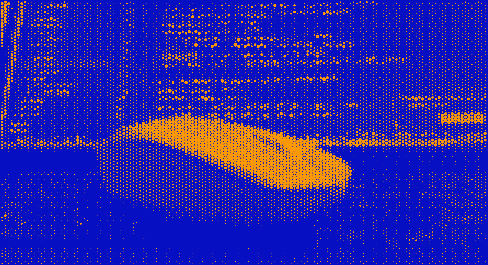
</div>

### Voxel

<div align="center">
  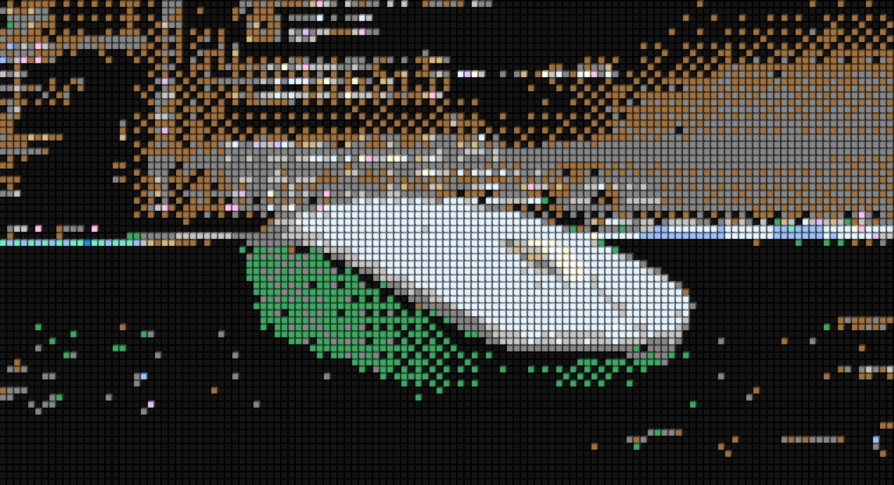
  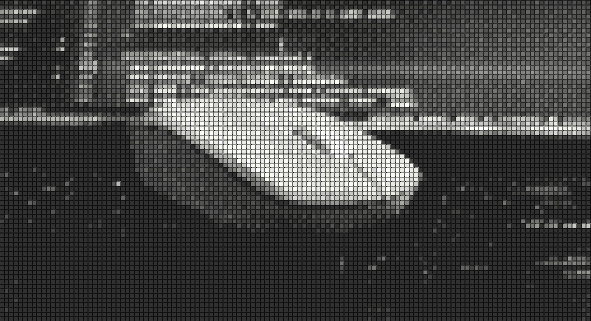
</div>

### Lines

<div align="center">
  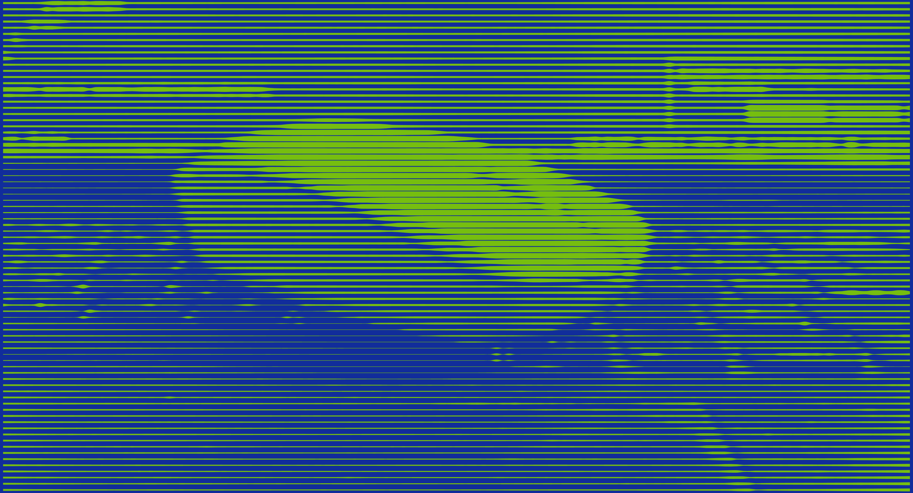
  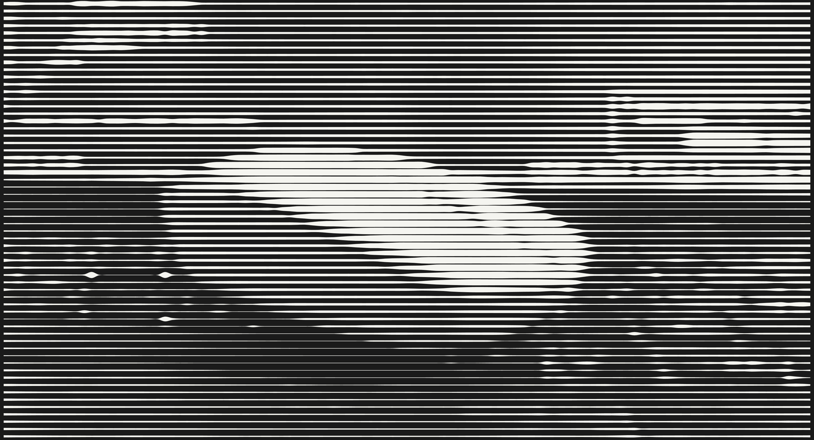
</div>

---

## Table of contents

- [Get the app](#get-the-app)
- [Features](#features)
- [Phosphor Studio](#phosphor-studio)
- [Getting started](#getting-started)
- [Usage](#usage)
- [Configuration](#configuration)
- [Tech stack](#tech-stack)
- [Browser support](#browser-support)
- [Contributing](#contributing)
- [License](#license)

## Features

- **Real-Time Rendering**
  - Five interchangeable render engines: ASCII, Dither, Halftone, Voxel and Lines
  - Worker-based rendering that keeps the UI responsive at a target of 60 FPS
  - Live FPS, render time and output resolution readout
  - 22 ASCII character sets, from classic ramps to braille, runes and blocks
  - Horizontal or vertical line direction, and a 3D block mode for voxels

- **Phosphor Studio**
  - Edit any photo with the same five engines
  - Load from a file, drag and drop, clipboard paste, or built-in samples
  - Ten presets across Retro CRT, Print & Dither and Digital & 3D
  - Zoom, pan, pinch and double-click zoom, with a reset control
  - Hold to compare against the original photo
  - Undo and redo every adjustment, including slider and color gestures

- **Effects**
  - Seven optional passes with individual intensity: glow, bloom, halation, chromatic aberration, vignette, scanlines and grain
  - Effects apply to the live preview, saved images and exports

- **High-Quality Capture**
  - Capture scale from 1x to 20x
  - PNG, JPEG and WEBP output
  - Video recording of the rendered camera output
  - Copy the rendered image (Studio) or the ASCII text to the clipboard

- **Customizable Settings**
  - Character size from 2 to 30 px
  - Contrast from 0.5x to 3.0x and brightness from −100 to +100
  - Color mode, invert, and custom foreground and background colors
  - Six color presets, a color wheel, hex input, random colors and a foreground/background swap

- **Camera Controls**
  - Front/back camera switching
  - Mirrored front-camera preview
  - High-quality snapshot export

- **Performance Monitoring** — Real-time FPS and render time display

- **Android app** — Native, offline-first Android build, signed and published with every release

---

## Phosphor Studio

Studio is the photo-editing side of the app, opened from the **Studio** button beside the settings action in the camera view (or directly at `/studio`).

1. **Add an image** with the file picker, by dropping it on the viewport, by pasting with `Ctrl`/`Cmd` + `V`, or by choosing a sample.
2. **Pick a preset** or set the engine and controls manually. The inspector is a side panel on desktop and a draggable bottom sheet on phones.
3. **Inspect the result** with zoom, pan, pinch and hold-to-compare.
4. **Export** with the Export button, or undo/redo and reset from the header.

Uploaded photos are downscaled to at most 1,600 px on the long edge and to roughly the viewport's pixel budget before editing. This keeps previews responsive and stops a high-scale export from allocating an enormous canvas. Studio supports images only for now; video editing is planned for a later release.

---

## Getting started

### Prerequisites

- [Bun](https://bun.sh/) 1.4 or later (the project pins `bun@1.4.0`)
- A device with a camera
- A secure context (HTTPS or `localhost`), required by browsers for camera access

### Installation

```bash
git clone https://github.com/pshycodr/phosphor-cam.git
cd phosphor-cam
bun install
```

### Development

```bash
bun run dev
```

The app is served at `http://localhost:5173`.

### Production build

```bash
bun run build
bun run preview
```

## Usage

### Camera

1. **Allow camera access** when the browser prompts.
2. **Select a render engine** (ASCII, Dither, Halftone, Voxel or Lines) in the settings panel.
3. **Tune the image** under Adjustments, Effects and Appearance. Changes apply to the live feed immediately.
4. **Capture** a frame with the shutter button, or copy it as text with the copy button.
5. **Switch cameras** with the flip button.
6. **Open Studio** with the Studio button to edit a photo instead.

The settings panel appears as a bottom sheet on phones (swipe down or tap outside to close) and as a side panel on larger screens (press `Esc` to close).

### Studio

Use the **Studio** button in the camera header, or visit `/studio`. Load an image, choose a preset or configure the look manually, then export. Undo with `Ctrl`/`Cmd` + `Z`, redo with `Ctrl`/`Cmd` + `Shift` + `Z` or `Ctrl` + `Y`, and hold the Compare button to see the original.

## Configuration

| Setting                   | Range / options                                                                                      | Engine                         |
| ------------------------- | ---------------------------------------------------------------------------------------------------- | ------------------------------ |
| Render engine             | ASCII, Dither, Halftone, Voxel, Lines                                                                | All                            |
| Character size            | 2 to 30 px                                                                                           | All                            |
| Contrast                  | 0.5x to 3.0x                                                                                         | All                            |
| Brightness                | −100 to +100                                                                                         | All                            |
| Character set             | 22 sets: standard, simple, blocks, matrix, edges, …                                                  | ASCII                          |
| Color mode                | On / off                                                                                             | All                            |
| Foreground and background | Any hex color, a color wheel, or one of six presets                                                  | All                            |
| Invert                    | On / off                                                                                             | All                            |
| Voxel 3D mode             | On / off                                                                                             | Voxel                          |
| Line direction            | Horizontal / vertical                                                                                | Lines                          |
| Effects                   | Glow, bloom, halation, chromatic aberration, vignette, scanlines, grain (each on/off with intensity) | All                            |
| Capture scale             | 1x to 20x (warning above 12x)                                                                        | ASCII, Dither, Halftone, Voxel |
| Capture codec             | PNG, JPEG, WEBP                                                                                      | All                            |

Character size controls how large each output cell is: larger values produce fewer, coarser cells, and smaller values produce finer detail at a higher processing cost.

## Tech stack

- **React** and **TypeScript**
- **Vite**
- **Tailwind CSS**
- **Canvas 2D API** for rendering
- **MediaStream API** for camera access
- **Capacitor** for the Android build
- **Lucide** and **React Icons** for iconography

## Browser support

Requires `getUserMedia`, Canvas 2D and ES2020+ support.

| Chrome | Firefox | Safari | Edge |
| ------ | ------- | ------ | ---- |
| 90+    | 88+     | 14+    | 90+  |

## Contributing

Contributions are welcome. Please read [CONTRIBUTING.md](CONTRIBUTING.md) before opening a pull request.

1. Fork the repository
2. Create a feature branch: `git checkout -b feature/short-description`
3. Commit your changes with a clear message
4. Push the branch and open a pull request

To report a defect or propose a feature, [open an issue](https://github.com/pshycodr/phosphor-cam/issues).

## License

Released under the MIT License. See [LICENSE](LICENSE) for details.
